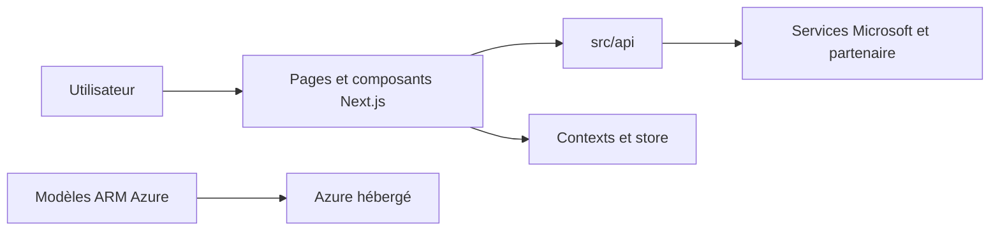

# KelvinTegelaar/CIPP

> Multi-tenant administration portal for Microsoft partners who manage several customers.

## The problem
Microsoft's partner model makes managing many tenants manual and time-consuming.

## What it actually does
The README only says the tool helps with administration, user management and deploying standards. From the code: a Next.js/React application (identity, mail, endpoints and tenants pages), state contexts and store, Azure ARM templates and GitHub Actions workflows; calls go out to Microsoft services.

## How it is wired

## Trying it
No command documented in the README; it points to the website and the documentation.

## Cost and gotchas
A Microsoft partner account and an Azure deployment are required: the hosting cost is not stated. AGPL-3.0: modifications served over a network must be published.

## What it is not
The README states that it is not a security tool nor a way to reduce subscription costs.

## Alternatives
The README mentions Microsoft Lighthouse as a possible but lagging solution, with no repository link.

## For you
Ignore: a Microsoft managed-service-provider tool, unrelated to data or MLOps work, and under AGPL.
