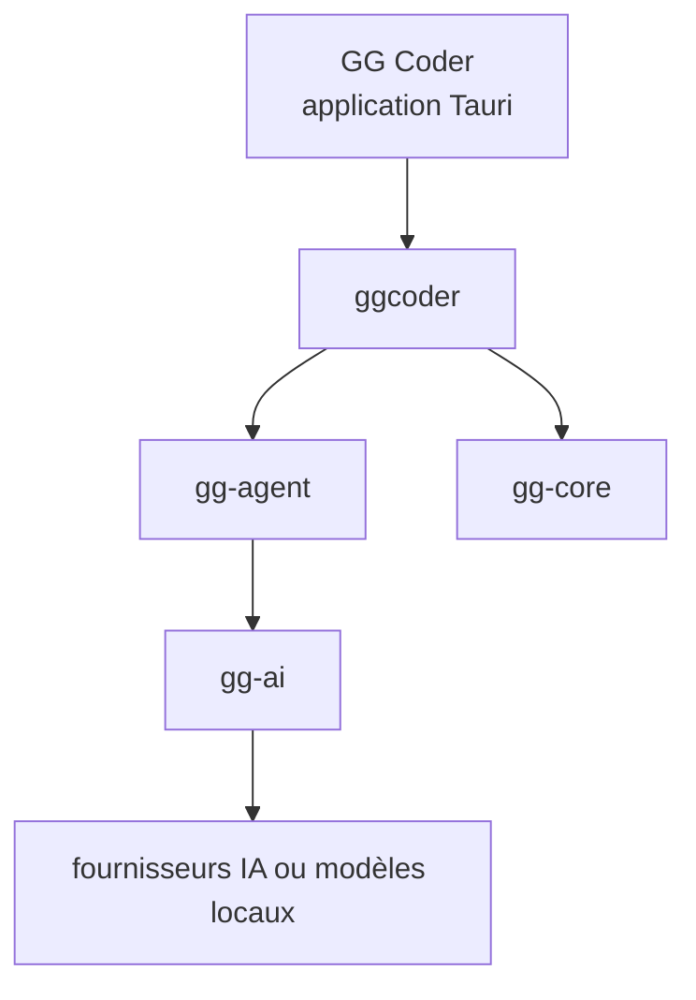

# KenKaiii/gg-framework

> Desktop coding agent (GG Coder) and npm packages for building agents on top of your AI subscriptions.

## The problem
Coding agents quickly burn through a subscription's quota, and you can't tell when the work has really been verified.

## What it actually does
Desktop application (Tauri): coding, chat, video (GG Motion), multi-agent goals (GG Goals), security and accessibility checks. Connects to Claude, ChatGPT, Kimi, MiniMax, MiMo, an API key or local models. npm packages: gg-ai, gg-agent, gg-core, ggcoder.

## How it is wired
Simplified diagram based on the fiche, no diagram provided.


## Trying it
```bash
git clone https://github.com/KenKaiii/gg-framework.git
cd gg-framework
pnpm install
pnpm build
pnpm --filter gg-app tauri dev
npm install @kenkaiiii/gg-ai @kenkaiiii/gg-agent
```

## Cost and gotchas
Subscription or API key at your own expense. The speed and cost figures come from the author's own benchmark, with no third party. AGPL: share the sources if offered as a network service.

## What it is not
Not a neutral agent: the comparison is made by the author. The README says nothing about the data sent to providers.

## Alternatives
In the README table: Goose, Kimi Code, Claude Code, Crush, Qwen Code, Hermes Agent.

## For you
One to watch: agent packages usable in TypeScript, but a single maintainer and a self-declared benchmark call for checking before adopting.
