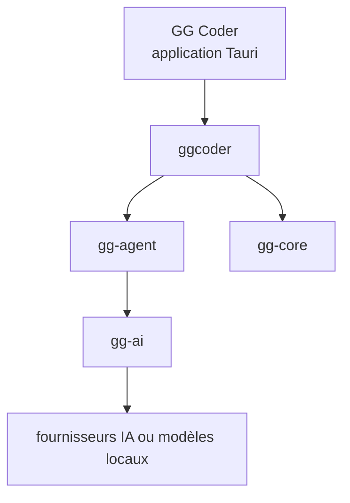

# KenKaiii/gg-framework

> Agent de code de bureau (GG Coder) et paquets npm pour bâtir des agents sur tes abonnements IA.

## Le problème
Les agents de code consomment vite le quota d'un abonnement, et on ne sait pas quand le travail est vraiment vérifié.

## Ce que ça fait vraiment
Application de bureau (Tauri) : codage, chat, vidéo (GG Motion), objectifs multi-agents (GG Goals), vérifications de sécurité et d'accessibilité. Se connecte à Claude, ChatGPT, Kimi, MiniMax, MiMo, à une clé d'API ou à des modèles locaux. Paquets npm : gg-ai, gg-agent, gg-core, ggcoder.

## Comment c'est branché
Schéma simplifié d'après la fiche, sans diagramme fourni.


## Essayer
```bash
git clone https://github.com/KenKaiii/gg-framework.git
cd gg-framework
pnpm install
pnpm build
pnpm --filter gg-app tauri dev
npm install @kenkaiiii/gg-ai @kenkaiiii/gg-agent
```

## Coût et pièges
Abonnement ou clé d'API à ta charge. Les chiffres de vitesse et de coût viennent d'un banc d'essai de l'auteur, sans tiers. AGPL : partager les sources en cas de service réseau.

## Ce que ce n'est pas
Pas un agent neutre : la comparaison est faite par l'auteur. Le README ne dit rien sur les données envoyées aux fournisseurs.

## Alternatives
Dans le tableau du README : Goose, Kimi Code, Claude Code, Crush, Qwen Code, Hermes Agent.

## Pour toi
À surveiller : paquets d'agents utilisables en TypeScript, mais mainteneur unique et benchmark auto-déclaré invitent à vérifier avant d'adopter.

