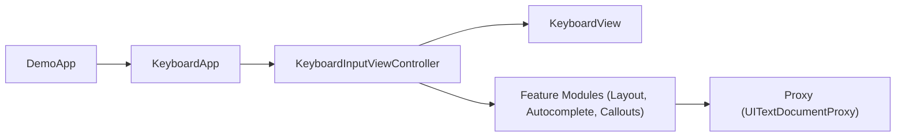

# KeyboardKit/KeyboardKit

> Swift/SwiftUI framework for building iOS keyboard extensions, with a paid Pro version.

## The problem
Apple's keyboard API is limited: layout, autocomplete, callouts and haptic feedback have to be rebuilt by hand.

## What it actually does
Provides an open base (actions, layouts, callouts, audio/haptic feedback, status, themes, text proxy) and a Pro version under a license key (localization in 75 languages, autocomplete, emojis, AI, themes). The README specifies that it is a binary framework, linked to the main target only. An example of autocomplete via Claude appears in the configuration.

## How it is wired


## Trying it
```swift
// Package Swift Package Manager : https://github.com/KeyboardKit/KeyboardKit.git
class KeyboardController: KeyboardInputViewController {}
```
```bash
git clone https://github.com/KeyboardKit/KeyboardKit.git
```

## Cost and gotchas
The core is free; Pro features require a paid license. A license file is present but not recognized by GitHub: read it before commercial use.

## What it is not
Not cross-platform: iOS only. The "open source" covers the engine, not the Pro features.

## Alternatives
No alternative named in the README.

## For you
Ignore: iOS app development, unrelated to data or AI, and unidentified license.
