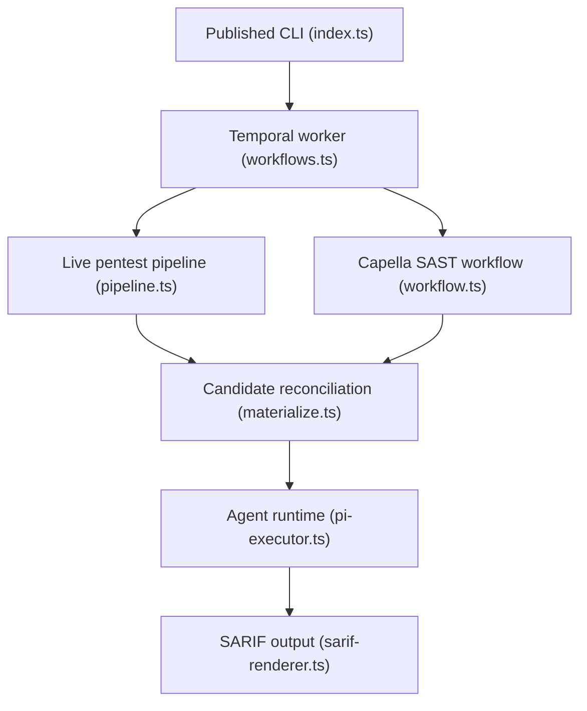

# KeygraphHQ/shannon

> Web and API penetration testing agent, designed to be run locally on your own code, for development teams.

## The problem
A human penetration test is only performed once a year, while the code is continuously updated. Between audits, vulnerabilities are introduced into production without being detected.

## What it actually does
Shannon reviewed the source code of an application, identifying potential vulnerabilities (such as injection, XSS, SSRF, authentication, and authorization issues), and then attempted to demonstrate them on a running instance. Only vulnerabilities that can be proven with a proof of concept are included in the report; the rest are excluded. Outputs: PDF, Markdown, JSON, SARIF 2.1.0. It can be used from the command line or in CI (GitHub Action, GitLab). Use is strictly limited to applications that you own or have explicit written permission for, never in a production environment.

## How it is wired


## Trying it
```bash
npx @keygraph/shannon@latest setup

npx @keygraph/shannon@latest start \
  -u https://your-app.com \
  -r /path/to/your/repo
```

## Cost and gotchas
API key for a model provider (Anthropic, OpenAI, xAI, Bedrock, or local model); a scan takes approximately 1 to 1.5 hours. Filters provided by the provider that focus on "cyber" aspects can interrupt a scan: plan for their verification schedule.

## What it is not
Not a passive scanner: it creates users, submits forms, and modifies the target's state, therefore a disposable environment is required. Reports require human review. The "black box," SCA (Secure Coding Assistant), and vulnerability management features are only available in the paid versions (Pro, Enterprise). Do not use it on untrusted code (prompt injection).

## Alternatives
- Keygraph Pro / Enterprise: These are commercial editions of the same engine, featuring a black-box, SCA (Software Composition Analysis), and vulnerability tracking.

## For you
Things to watch out for: useful for testing your own APIs and AI applications in a staging environment using CI, but AGPL-3.0, token costs, and vendor filters require careful consideration before adoption.
