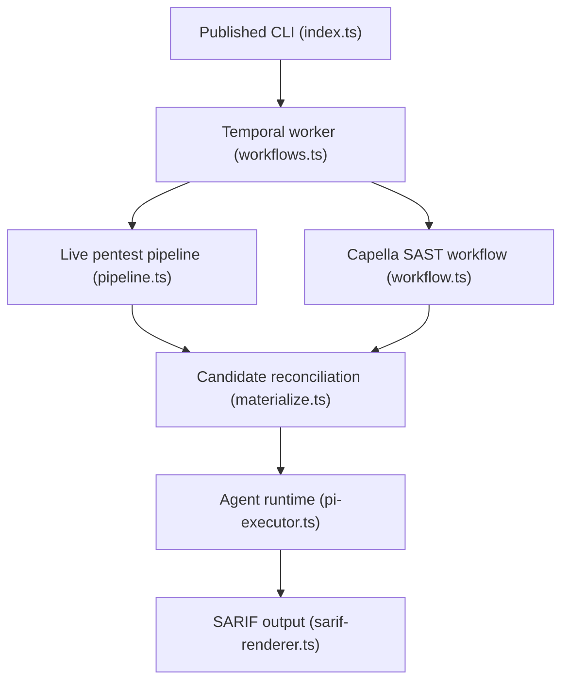

# KeygraphHQ/shannon

> Agent IA de test d'intrusion web et API, lancé en local sur ton propre code, pour équipes dev.

## Le problème
Un pentest humain n'a lieu qu'une fois par an alors que le code est livré en continu. Entre deux audits, des failles partent en production sans être vues.

## Ce que ça fait vraiment
Shannon lit le code source d'une application, repère des pistes de vulnérabilité (injection, XSS, SSRF, authentification, autorisation), puis tente de les prouver sur une instance en cours d'exécution. Seules les failles démontrées par une preuve de concept entrent dans le rapport ; le reste est écarté. Sorties : PDF, Markdown, JSON, SARIF 2.1.0. Il s'utilise en ligne de commande ou en CI (GitHub Action, GitLab). Usage légitime uniquement : sur des applications dont tu es propriétaire ou avec autorisation écrite, jamais en production.

## Comment c'est branché


## Essayer
```bash
npx @keygraph/shannon@latest setup

npx @keygraph/shannon@latest start \
  -u https://your-app.com \
  -r /path/to/your/repo
```

## Coût et pièges
Clé d'API d'un fournisseur de modèles à ta charge (Anthropic, OpenAI, xAI, Bedrock, ou modèle local) ; un scan dure environ 1 à 1,5 h. Les filtres « cyber » des fournisseurs peuvent interrompre un scan : prévoir leur programme de vérification.

## Ce que ce n'est pas
Pas un scanner passif : il crée des utilisateurs, soumet des formulaires et modifie l'état de la cible, donc environnement jetable obligatoire. Les rapports exigent une relecture humaine. Le black-box, le SCA et la gestion des failles sont réservés aux éditions payantes (Pro, Enterprise). Ne pas l'utiliser sur du code non fiable (injection de prompt).

## Alternatives
- Keygraph Pro / Enterprise : éditions commerciales du même moteur, avec black-box, SCA et suivi des failles.

## Pour toi
À surveiller : utile pour tester tes propres API et applications IA en staging via la CI, mais AGPL-3.0, coût en jetons et filtres des fournisseurs demandent un pilote avant adoption.

