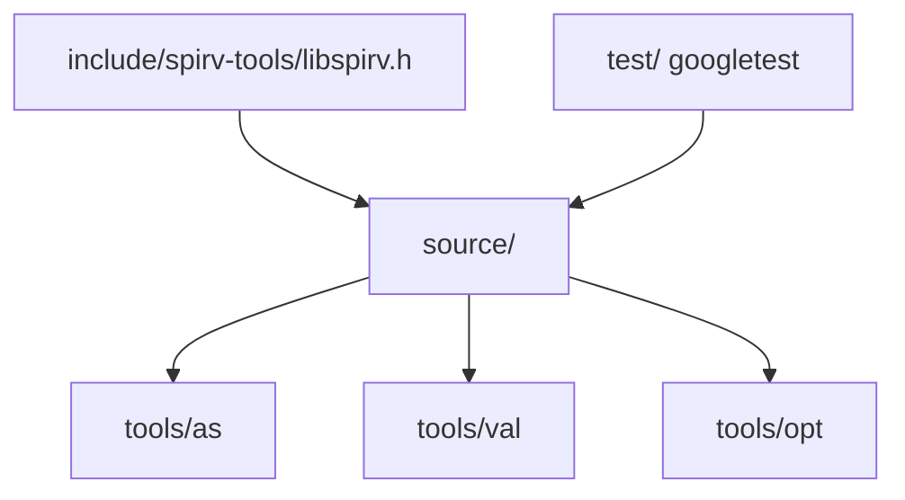

# KhronosGroup/SPIRV-Tools

> API and command-line tools to assemble, validate, optimize and manipulate SPIR-V modules.

## The problem
Shader and GPU kernel compilers produce unreadable binary SPIR-V, hard to verify or optimize.

## What it actually does
A C and C++ library with an assembler, disassembler, validator (incomplete, one-way errors), 67-pass optimizer, linker, reducer, fuzzer and diff tool, plus the executables `spirv-as`, `spirv-dis`, `spirv-val`, `spirv-opt`, `spirv-link`, `spirv-reduce`, `spirv-diff`. The README states that the linker, reducer, fuzzer and diff are under development.

## How it is wired
Simplified diagram based on the sheet, no diagram provided.


## Trying it
```sh
git clone https://github.com/KhronosGroup/SPIRV-Tools.git spirv-tools
cd spirv-tools
python3 utils/git-sync-deps
mkdir build && cd build
cmake <spirv-dir>
cmake --build .
```

## Cost and gotchas
Free. Python 3, CMake (or Bazel) and a C++17 compiler required; official binaries come from the LunarG Vulkan SDK. The truncated README does not detail the tests.

## What it is not
Not a shader compiler. The GitHub releases are abandoned.

## Alternatives
No alternative named in the README.

## For you
Ignore: shader and GPU compiler tooling, unless you write compilers or Vulkan kernels.
