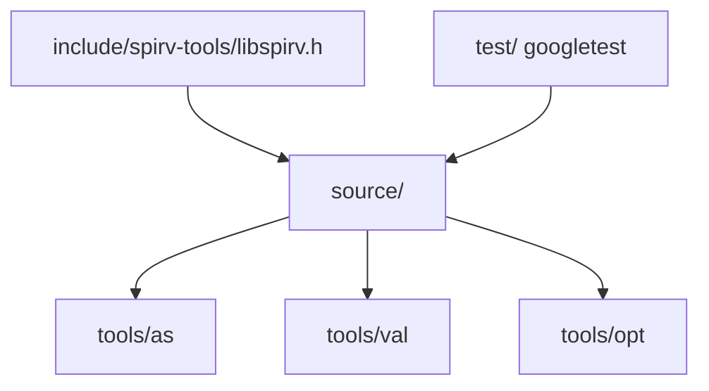

# KhronosGroup/SPIRV-Tools

> API et outils en ligne de commande pour assembler, valider, optimiser et manipuler des modules SPIR-V.

## Le problème
Les compilateurs de shaders et de noyaux GPU produisent du SPIR-V binaire illisible, difficile à vérifier ou à optimiser.

## Ce que ça fait vraiment
Une bibliothèque C et C++ avec assembleur, désassembleur, validateur (incomplet, erreurs à sens unique), optimiseur de 67 passes, éditeur de liens, réducteur, fuzzer et comparateur, plus des exécutables `spirv-as`, `spirv-dis`, `spirv-val`, `spirv-opt`, `spirv-link`, `spirv-reduce`, `spirv-diff`. Le README indique que le linker, le réducteur, le fuzzer et le diff sont en développement.

## Comment c'est branché
Schéma simplifié d'après la fiche, sans diagramme fourni.


## Essayer
```sh
git clone https://github.com/KhronosGroup/SPIRV-Tools.git spirv-tools
cd spirv-tools
python3 utils/git-sync-deps
mkdir build && cd build
cmake <spirv-dir>
cmake --build .
```

## Coût et pièges
Gratuit. Python 3, CMake (ou Bazel) et un compilateur C++17 requis ; les binaires officiels viennent du SDK Vulkan de LunarG. Le README tronqué ne détaille pas les tests.

## Ce que ce n'est pas
Pas un compilateur de shaders. Les releases GitHub sont abandonnées.

## Alternatives
Aucune alternative nommée dans le README.

## Pour toi
Ignorer : outillage de shaders et de compilateurs GPU, sauf si tu écris des compilateurs ou des noyaux Vulkan.

