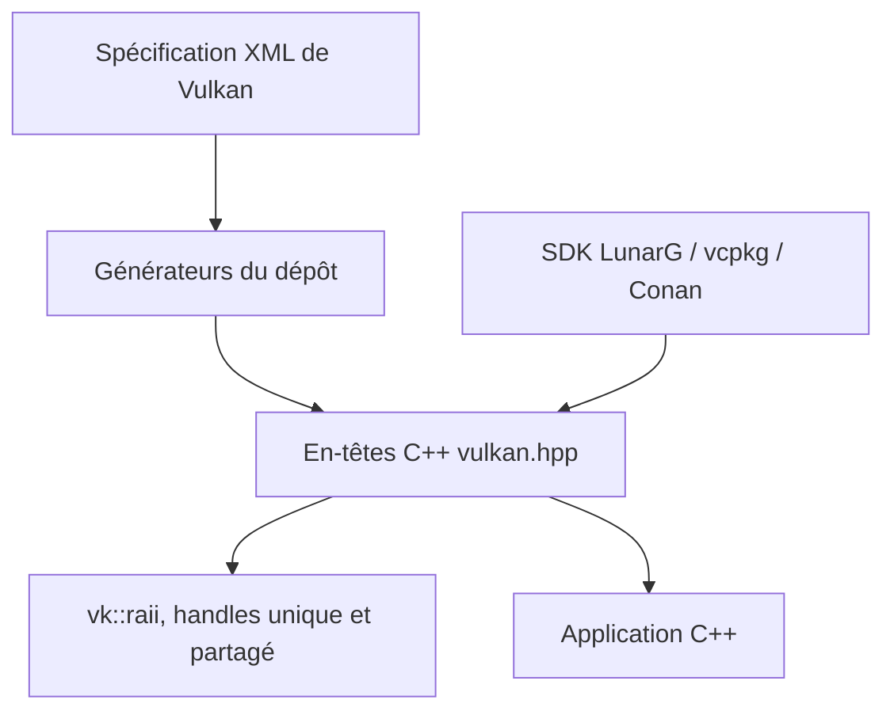

# KhronosGroup/Vulkan-Hpp

> Header-only C++ bindings for the Vulkan API, for graphics and GPU compute developers.

## The problem
Vulkan's C API is verbose and not strongly typed: enumerations and bitmasks get mixed up, and resource release is manual.

## What it actually does
Provides C++ headers generated from Vulkan's XML specification. They bring typed enumerations and bitmasks, STL containers, exceptions and three families of handles: unique, shared and `vk::raii`. The repository also contains the generators. The README claims there is no runtime CPU cost.

## How it is wired
Simplified diagram based on the fiche, no diagram provided.



## Trying it
```bash
git clone https://github.com/Microsoft/vcpkg.git
cd vcpkg
./bootstrap-vcpkg.sh
./vcpkg integrate install
./vcpkg install vulkan-headers
```
The LunarG SDK remains the recommended route.

## Cost and gotchas
Free. Breaking changes are not rare: dispatcher initialisation now requires `vkGetDeviceProcAddr`, and the named module `vulkan` requires `import std`.

## What it is not
Not a graphics engine or a compute library: only a typing layer on top of Vulkan. The vcpkg and Conan packages are maintained by the community, not by this repository.

## Alternatives
- No alternative named in the README.

## For you
Ignore unless you write C++ Vulkan: it is graphics infrastructure, outside the usual data, AI or MLOps scope.
