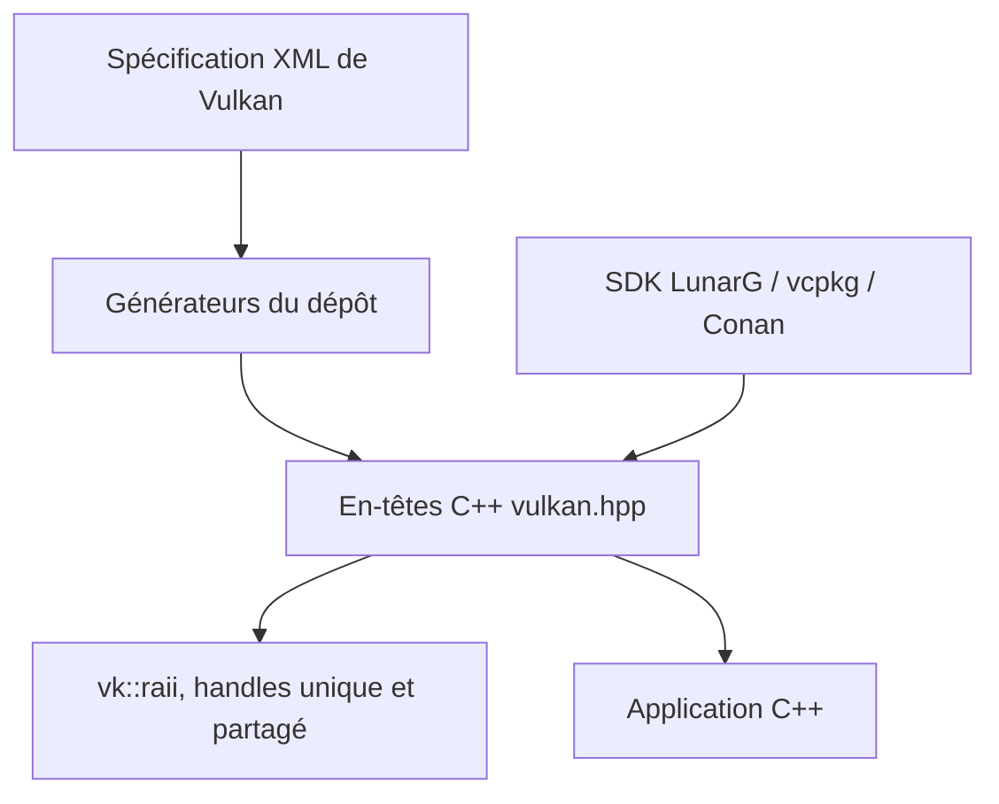

# KhronosGroup/Vulkan-Hpp

> Liaisons C++ en en-têtes seuls pour l'API Vulkan, pour développeurs graphique et calcul GPU.

## Le problème
L'API C de Vulkan est verbeuse et sans typage fort : énumérations et masques de bits se mélangent, et la libération des ressources est manuelle.

## Ce que ça fait vraiment
Fournit des en-têtes C++ générés depuis la spécification XML de Vulkan. Ils apportent des énumérations et masques typés, des conteneurs STL, des exceptions et trois familles de handles : unique, partagé et `vk::raii`. Le dépôt contient aussi les générateurs. Le README affirme qu'il n'y a pas de coût CPU à l'exécution.

## Comment c'est branché
Schéma simplifié d'après la fiche, sans diagramme fourni.



## Essayer
```bash
git clone https://github.com/Microsoft/vcpkg.git
cd vcpkg
./bootstrap-vcpkg.sh
./vcpkg integrate install
./vcpkg install vulkan-headers
```
Le SDK LunarG reste la voie recommandée.

## Coût et pièges
Gratuit. Les changements cassants ne sont pas rares : l'initialisation du dispatcher exige désormais `vkGetDeviceProcAddr`, et le module nommé `vulkan` impose `import std`.

## Ce que ce n'est pas
Pas un moteur graphique ni une bibliothèque de calcul : seulement une couche de typage au-dessus de Vulkan. Les paquets vcpkg et Conan sont maintenus par la communauté, pas par ce dépôt.

## Alternatives
- Aucune alternative nommée dans le README.

## Pour toi
À ignorer sauf si tu écris du C++ Vulkan : c'est de l'infrastructure graphique, hors du périmètre data, IA ou MLOps courant.

