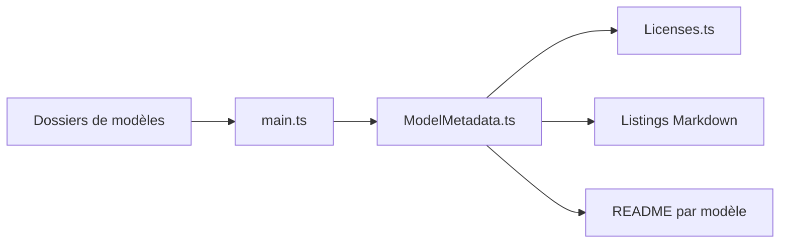

# KhronosGroup/glTF-Sample-Assets

> Collection of sample glTF 2.0 models illustrating the format's features, for 3D developers.

## The problem
3D viewers, converters and engines need varied, well-licensed test models.

## What it actually does
Models in separate, embedded or binary (.glb) glTF, listed by category (showcase, complete, tests, core only, tutorials, PBR tests, issues). A TypeScript utility validates metadata and generates listings, indexes and a README per model. A browsing site exists outside this repository. Each model has its own license; the README announces CC-BY-4.0, but the catalog detects no license.

## How it is wired

## Trying it
No command documented: open the browsing site linked in the README.

## Cost and gotchas
Free. Licenses vary by model (see each folder's README).

## What it is not
Not an engine or a conversion tool: test data.

## Alternatives
Khronos glTF Asset Generator, Sketchfab, Poly Haven, Kenney (cited in the README).

## For you
Ignore: a 3D dataset, useful only for testing a glTF loader.
