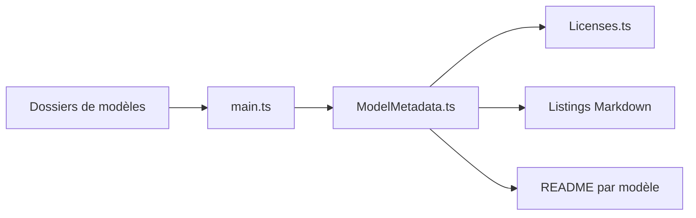

# KhronosGroup/glTF-Sample-Assets

> Collection de modèles glTF 2.0 d'exemple illustrant les fonctionnalités du format, pour développeurs 3D.

## Le problème
Les visionneuses, convertisseurs et moteurs 3D ont besoin de modèles de test variés et bien licenciés.

## Ce que ça fait vraiment
Modèles en glTF séparé, embarqué ou binaire (.glb), listés par catégories (vitrine, complet, tests, noyau seul, tutoriels, tests PBR, problèmes). Un utilitaire TypeScript valide les métadonnées et génère listes, index et README par modèle. Un site de navigation existe hors de ce dépôt. Chaque modèle a sa licence ; le README annonce CC-BY-4.0, mais le catalogue ne détecte aucune licence.

## Comment c'est branché

## Essayer
Aucune commande documentée : ouvrir le site de navigation du README.

## Coût et pièges
Gratuit. Licences variables selon le modèle (voir le README de chaque dossier).

## Ce que ce n'est pas
Pas un moteur ni un outil de conversion : des données de test.

## Alternatives
Khronos glTF Asset Generator, Sketchfab, Poly Haven, Kenney (cités dans le README).

## Pour toi
À ignorer : jeu de données 3D, utile seulement pour tester un chargeur glTF.

