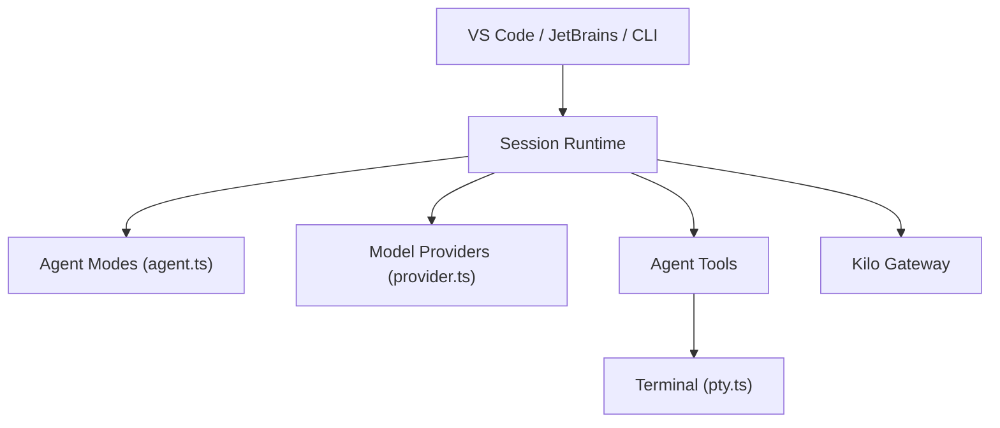

# Kilo-Org/kilocode

> AI coding agent for VS Code, JetBrains and CLI, with over 500 models at provider pricing.

## The problem
Switching coding assistant or model depending on the task, without being locked into a single provider.

## What it actually does
Specialized agents (Code, Plan, Ask, Debug), inline autocompletion, terminal command execution and browser control, self-verification. A `kilo run --auto` mode for CI. A marketplace of agents, skills and MCP servers. The CLI is a fork of OpenCode. New features go on the `v2` branch, not `main`.

## How it is wired


## Trying it
```bash
npm install -g @kilocode/cli
kilo
kilo run --auto "run tests and fix any failures"
```

## Cost and gotchas
An account is created to access the models; you pay the provider's price, with no markup according to the README. `--auto` approves everything except what a deny rule blocks: reserve it for trusted environments.

## What it is not
Not a model: a client that routes to third-party models. Not all internal runtime links are verified in the architecture provided.

## Alternatives
- OpenCode: the project the CLI is derived from.

## For you
Keep an eye on it: useful for comparing models in the IDE, but the switch from `main` to `v2` signals a version in flux.
