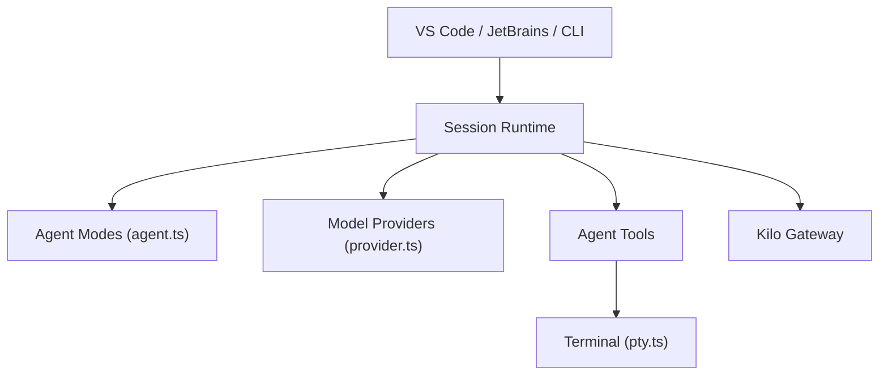

# Kilo-Org/kilocode

> Agent de codage IA pour VS Code, JetBrains et CLI, avec plus de 500 modèles au tarif du fournisseur.

## Le problème
Changer d'assistant de code ou de modèle selon la tâche, sans être enfermé chez un seul fournisseur.

## Ce que ça fait vraiment
Agents spécialisés (Code, Plan, Ask, Debug), autocomplétion en ligne, exécution de commandes terminal et contrôle navigateur, auto-vérification. Mode `kilo run --auto` pour la CI. Une marketplace d'agents, skills et serveurs MCP. La CLI est un fork d'OpenCode. Les nouvelles fonctions vont sur la branche `v2`, pas `main`.

## Comment c'est branché


## Essayer
```bash
npm install -g @kilocode/cli
kilo
kilo run --auto "run tests and fix any failures"
```

## Coût et pièges
Un compte est créé pour accéder aux modèles ; tu paies le tarif du fournisseur, sans marge selon le README. `--auto` approuve tout sauf règle de refus : réservé aux environnements de confiance.

## Ce que ce n'est pas
Pas un modèle : un client qui route vers des modèles tiers. Les liens internes d'exécution ne sont pas tous vérifiés dans l'architecture fournie.

## Alternatives
- OpenCode : le projet dont la CLI est dérivée.

## Pour toi
À surveiller : utile pour comparer des modèles dans l'IDE, mais le basculement de `main` vers `v2` annonce une version en mouvement.

