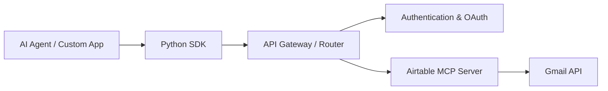

# Klavis-AI/klavis

> Catalog of ready-to-use MCP servers and the Strata router, hosted or self-hosted.

## The problem
Connecting an agent to Gmail, Slack, GitHub… requires an MCP server and an OAuth flow per service.

## What it actually does
One MCP server per integration, each as a Docker image (`ghcr.io/klavis-ai/...`).
Strata: an MCP server that aggregates several integrations for a user.
Python and TypeScript SDKs and a REST API to create instances per `user_id`.
The README is very brief; the detail is in the external docs.

## How it is wired


## Trying it
```bash
docker pull ghcr.io/klavis-ai/github-mcp-server:latest
docker run -p 5000:5000 ghcr.io/klavis-ai/github-mcp-server:latest
pipx install strata-mcp
strata add --type stdio playwright npx @playwright/mcp@latest
```

## Cost and gotchas
The hosted offer requires a klavis.ai key; self-hosting goes through Docker. Pricing not documented.

## What it is not
Not an agent framework. The README describes neither the security of OAuth tokens nor the limits of the free tier.

## Alternatives
No alternative named in the README.

## For you
Worth watching: a handy shortcut to equip an agent with SaaS tools, but the README is too thin to judge how much trust to give whoever holds your tokens.
