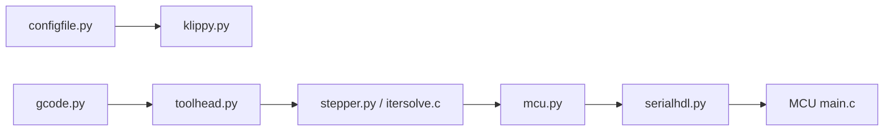

# Klipper3d/klipper

> 3D printer firmware pairing a host computer with microcontrollers.

## The problem
A microcontroller alone is poor at computing 3D printer motion planning.

## What it actually does
Minimal README. From the code: the host (klippy.py) reads the configuration and the G-code, plans the motion (toolhead.py, kinematics, stepper), translates it into timed activity sent to the MCU firmware (mcu.py, serialhdl.py, clocksync.py). The MCU firmware (main.c) drives the hardware.

## How it is wired

## Trying it
No command in the README; it points to the installation documentation on the site.

## Cost and gotchas
Free, but requires a compatible printer and a microcontroller to flash.

## What it is not
Not a slicer. Not a generic software tool: it drives hardware.

## Alternatives
No alternative named in the README.

## For you
Outside the data/AI scope: only of interest if you own a 3D printer.
