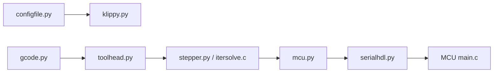

# Klipper3d/klipper

> Firmware d'imprimante 3D associant un ordinateur hôte et des microcontrôleurs.

## Le problème
Un microcontrôleur seul calcule mal la planification de mouvement des imprimantes 3D.

## Ce que ça fait vraiment
README minimal. D'après le code : l'hôte (klippy.py) lit la configuration et le G-code, planifie le mouvement (toolhead.py, cinématique, stepper), le traduit en activité temporisée envoyée au firmware MCU (mcu.py, serialhdl.py, clocksync.py). Le firmware MCU (main.c) pilote le matériel.

## Comment c'est branché

## Essayer
Aucune commande dans le README ; il renvoie à la documentation d'installation du site.

## Coût et pièges
Gratuit, mais exige une imprimante compatible et un microcontrôleur à flasher.

## Ce que ce n'est pas
Pas un slicer. Pas un outil logiciel générique : il pilote du matériel.

## Alternatives
Aucune alternative nommée dans le README.

## Pour toi
Hors périmètre data/IA : ne t'y intéresse que si tu possèdes une imprimante 3D.

