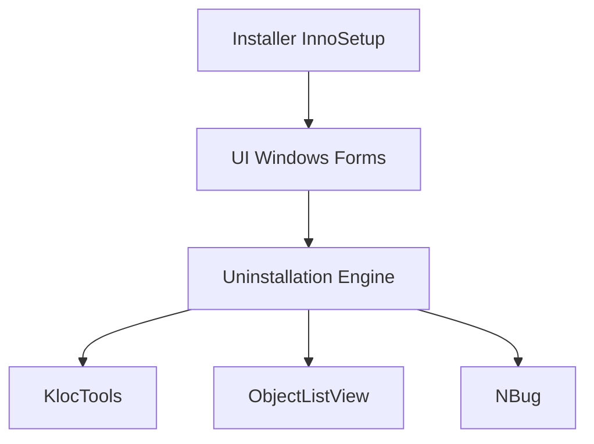

# Klocman/Bulk-Crap-Uninstaller

> Bulk Windows uninstaller that also cleans up leftovers, for administrators and home users.

## The problem
Uninstalling dozens of Windows applications one by one, with leftovers and a variety of uninstaller formats, is slow.

## What it actually does
Detects installed applications (Store, Steam, Windows features, NSIS, InnoSetup, Msiexec), uninstalls them in batches, spots orphaned ones and cleans up leftovers. Windows Forms interface; Setup, Portable and net variants.

## How it is wired


## Trying it
```bash
# Windows : télécharger Setup, Portable ou net depuis la page des releases
# compilation : Visual Studio 2022, puis publish.bat
```

## Cost and gotchas
Free. .NET 8 required except for the Portable version. The README asks for maintainers.

## What it is not
Not a cross-platform tool, nor a data/AI one. Windows only.

## Alternatives
No alternative named.

## For you
Ignore: a Windows utility with no link to data/AI/MLOps.
