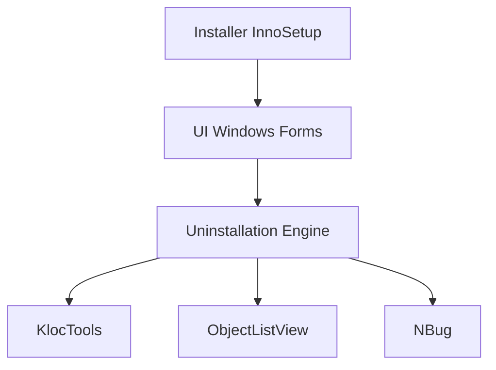

# Klocman/Bulk-Crap-Uninstaller

> Désinstalleur Windows en masse qui nettoie aussi les restes, pour administrateurs et particuliers.

## Le problème
Désinstaller des dizaines d'applications Windows une à une, avec résidus et formats de désinstalleurs variés, est long.

## Ce que ça fait vraiment
Détecte les applications installées (Store, Steam, fonctionnalités Windows, NSIS, InnoSetup, Msiexec), les désinstalle en lot, repère les orphelines et nettoie les restes. Interface Windows Forms ; variantes Setup, Portable et net.

## Comment c'est branché


## Essayer
```bash
# Windows : télécharger Setup, Portable ou net depuis la page des releases
# compilation : Visual Studio 2022, puis publish.bat
```

## Coût et pièges
Gratuit. .NET 8 requis hors version Portable. Le README demande des mainteneurs.

## Ce que ce n'est pas
Pas un outil multiplateforme ni data/IA. Windows uniquement.

## Alternatives
Aucune alternative nommée.

## Pour toi
Ignorer : utilitaire Windows sans lien avec data/IA/MLOps.

