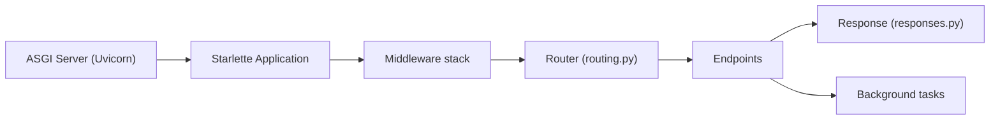

# Kludex/starlette

> Lightweight ASGI toolkit for writing asynchronous web services in Python.

## The problem
Writing an async web service in Python without a heavy framework means reimplementing routing, middlewares, WebSocket and static files on top of ASGI.

## What it actually does
An ASGI application called by an external server (Uvicorn): it passes the request through a stack of middlewares (CORS, GZip, sessions, trusted hosts...), then a router sends it to an HTTP or WebSocket endpoint. Each building block (responses, static files, background tasks, test client) can be used on its own. External dependencies are optional (jinja2, httpx2, python-multipart, itsdangerous, pyyaml).

## How it is wired


## Trying it
```bash
pip install starlette
pip install uvicorn
uvicorn main:app
```

## Cost and gotchas
Free. An ASGI server has to be installed separately; `pip install starlette[full]` pulls in the optional dependencies.

## What it is not
Not an "all-inclusive" framework: no ORM, no data validation, no generated API documentation. The README mentions none of these layers.

## Alternatives
No alternative named in the README.

## For you
Adopt: it is the clean base for exposing a model or a data API asynchronously, under the BSD-3-Clause license, with few dependencies.
