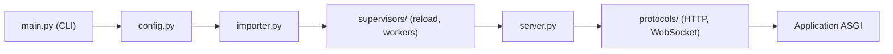

# Kludex/uvicorn

> ASGI web server for Python, to run asynchronous applications such as FastAPI or Starlette.

## The problem
WSGI servers handle long-lived connections (WebSocket, long-poll) and asynchronous applications poorly.

## What it actually does
It loads an ASGI application (`module:app`), opens the sockets, parses HTTP/1.1 and WebSocket (the README also mentions HTTP/2), sends ASGI messages to the application and returns the response. It handles the lifecycle (startup/shutdown), hot reload and multiple processes. The `standard` extras add `uvloop`, `httptools`, `websockets` and `watchfiles`.

## How it is wired


## Trying it
```bash
pip install uvicorn
pip install 'uvicorn[standard]'
uvicorn example:app
```

## Cost and gotchas
Free. The README mentions no gotcha; the `standard` install requires compiled packages.

## What it is not
Not a web framework: it runs an application that you write. Not a server for classic WSGI code, except via the `wsgi.py` adapter.

## Alternatives
Daphne (first ASGI server, for Django Channels), Hypercorn (supports trio), Granian (HTTP server in Rust), Mangum (AWS Lambda adapter).

## For you
Adopt: it is the default server to expose a model behind a FastAPI API, mature and with no imposed dependency.
