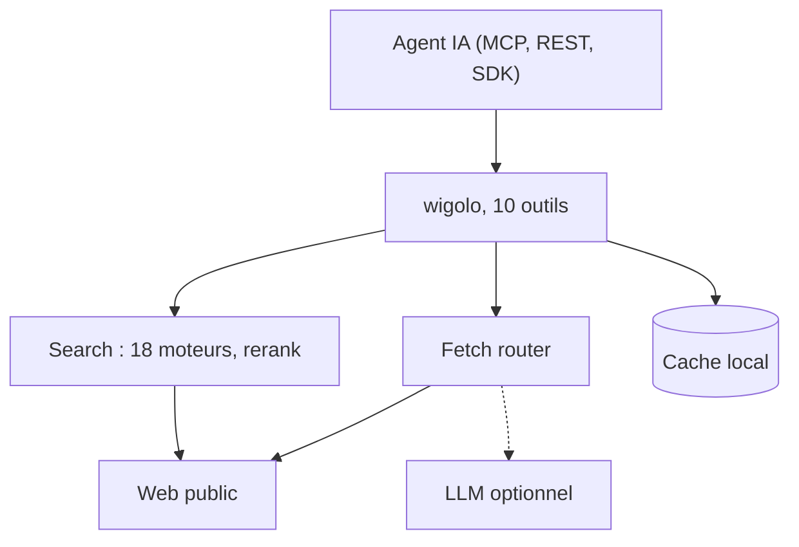

# KnockOutEZ/wigolo

> Local web layer for AI agents: search, read, crawl and extraction with no API key.

## The problem
Giving an agent access to the web goes through services billed per request (Tavily, Exa, Firecrawl) that send your queries to a third party.

## What it actually does
A Node process exposes ten tools over MCP, REST and SDK: multi-engine search with rank fusion and local reranking, fetch with escalation to a browser, crawl, extraction, local cache, find_similar, research, agent, diff and watch. The models run on your machine (about 1.5 GB of disk). For written answers, `research` and `agent` use an LLM of your choice (Gemini, Anthropic, OpenAI, Groq, Ollama).

## How it is wired


## Trying it
```bash
npx wigolo init
npx wigolo init --agents=claude-code,cursor
npx wigolo doctor
wigolo serve
```

## Cost and gotchas
Free for search, fetch and crawl; an LLM for synthesis may need a key at your expense (a free Gemini key is suggested). About 1.5 GB of disk, public beta. Datacenter IPs may be blocked by some sites.

## What it is not
Not a guaranteed equivalent of the paid services: the README admits the paid ones win on some deep-extraction cases. The license is presented as AGPL with a commercial license for companies: read it before professional use.

## Alternatives
- Firecrawl: whole-site crawl and managed service.
- Exa: renders the official docs matrix in full.
- Tavily: managed service, no local installation.

## For you
Worth watching: useful to give your agents the web without a bill, but the license needs clarifying and it is a recent project carried by a single person.
