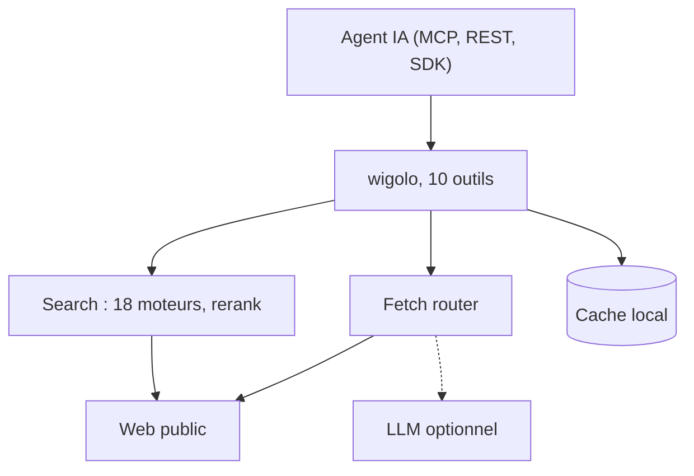

# KnockOutEZ/wigolo

> Couche web locale pour agents IA : recherche, lecture, crawl et extraction sans clé d'API.

## Le problème
Donner le web à un agent passe par des services facturés à la requête (Tavily, Exa, Firecrawl) qui envoient tes requêtes chez un tiers.

## Ce que ça fait vraiment
Un processus Node expose dix outils en MCP, REST et SDK : recherche multi-moteurs avec fusion de rangs et reranking local, fetch avec escalade vers un navigateur, crawl, extraction, cache local, find_similar, research, agent, diff et watch. Les modèles tournent sur la machine (environ 1,5 Go de disque). Pour des réponses rédigées, `research` et `agent` utilisent un LLM au choix (Gemini, Anthropic, OpenAI, Groq, Ollama).

## Comment c'est branché


## Essayer
```bash
npx wigolo init
npx wigolo init --agents=claude-code,cursor
npx wigolo doctor
wigolo serve
```

## Coût et pièges
Gratuit côté recherche, fetch et crawl ; un LLM pour la synthèse peut avoir une clé à ta charge (clé Gemini gratuite proposée). Environ 1,5 Go de disque, bêta publique. Les IP de datacenter peuvent être bloquées par certains sites.

## Ce que ce n'est pas
Pas l'équivalent garanti des services payants : le README admet que les payants gagnent sur certains cas d'extraction profonde. La licence est présentée comme AGPL avec licence commerciale pour les entreprises : à lire avant usage pro.

## Alternatives
- Firecrawl : crawl de site entier et service géré.
- Exa : rend la matrice de docs officielle en entier.
- Tavily : service géré, sans installation locale.

## Pour toi
À surveiller : utile pour donner du web à tes agents sans facture, mais licence à clarifier et projet récent porté par une seule personne.

