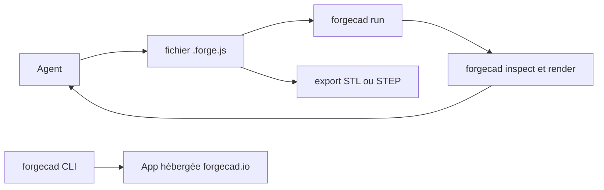

# KoStard/forgecad-public-kit

> Examples, agent skills and issue tracking for ForgeCAD, agent-drivable parametric CAD in JavaScript.

## The problem
Traditional CAD goes through a graphical interface that code agents drive poorly; modeling in code with checks allows an automatable iteration loop.

## What it actually does
A `.forge.js` file becomes a parametric model with assemblies, validation, renders and exports (STL, STEP). The `forgecad` CLI runs, renders, inspects collisions and sweeps parameters. The repository contains only the examples, the skills (`forgecad-build-model`, `forgecad-inspect-model`…), model benchmark archives and the issue tracker; the product and its code are not public.

## How it is wired


## Trying it
```bash
npm install -g forgecad
forgecad login
forgecad project clone start-here
forgecad studio .
forgecad skill install
forgecad run examples/products/cup.forge.js
```

## Cost and gotchas
The kit is under MIT, but the CLI, the application and use of the backend fall under the product's terms (pricing on the website). An account is required to clone hosted projects. Last push in June 2026.

## What it is not
Not the ForgeCAD software itself: the core is proprietary. The benchmark tables are historical, not recommendations.

## Alternatives
No alternative named in the README.

## For you
Worth watching: interesting as an example of an "agent edits code → tool inspects → iterates" loop; outside CAD, little direct use.
