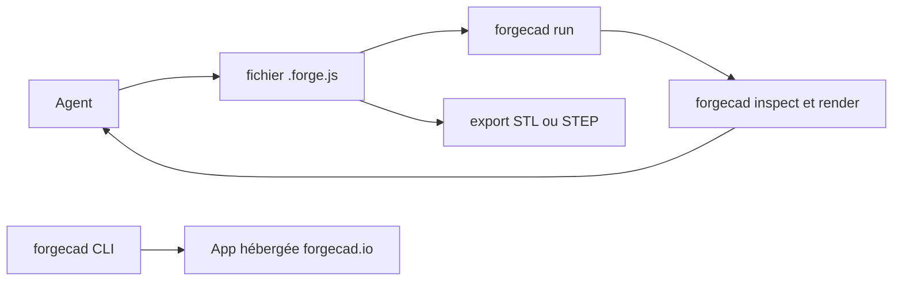

# KoStard/forgecad-public-kit

> Exemples, skills d'agents et suivi d'issues de ForgeCAD, CAO paramétrique en JavaScript pilotable par agent.

## Le problème
La CAO classique passe par une interface graphique que les agents de code pilotent mal ; modéliser en code avec vérifications permet une boucle d'itération automatisable.

## Ce que ça fait vraiment
Un fichier `.forge.js` devient un modèle paramétrique avec assemblages, validation, rendus et exports (STL, STEP). Le CLI `forgecad` exécute, rend, inspecte les collisions et balaie les paramètres. Le dépôt contient seulement les exemples, les skills (`forgecad-build-model`, `forgecad-inspect-model`…), des archives de benchmark de modèles et le suivi d'issues ; le produit et son code ne sont pas publics.

## Comment c'est branché


## Essayer
```bash
npm install -g forgecad
forgecad login
forgecad project clone start-here
forgecad studio .
forgecad skill install
forgecad run examples/products/cup.forge.js
```

## Coût et pièges
Le kit est sous MIT, mais le CLI, l'application et l'usage du backend relèvent des conditions du produit (tarifs sur le site). Compte requis pour cloner des projets hébergés. Dernier push en juin 2026.

## Ce que ce n'est pas
Pas le logiciel ForgeCAD lui-même : le cœur est propriétaire. Les tableaux de benchmark sont historiques, pas des recommandations.

## Alternatives
Aucune alternative nommée dans le README.

## Pour toi
À surveiller : intéressant comme exemple de boucle « agent édite du code → outil inspecte → itère » ; hors CAO, peu d'utilité directe.

