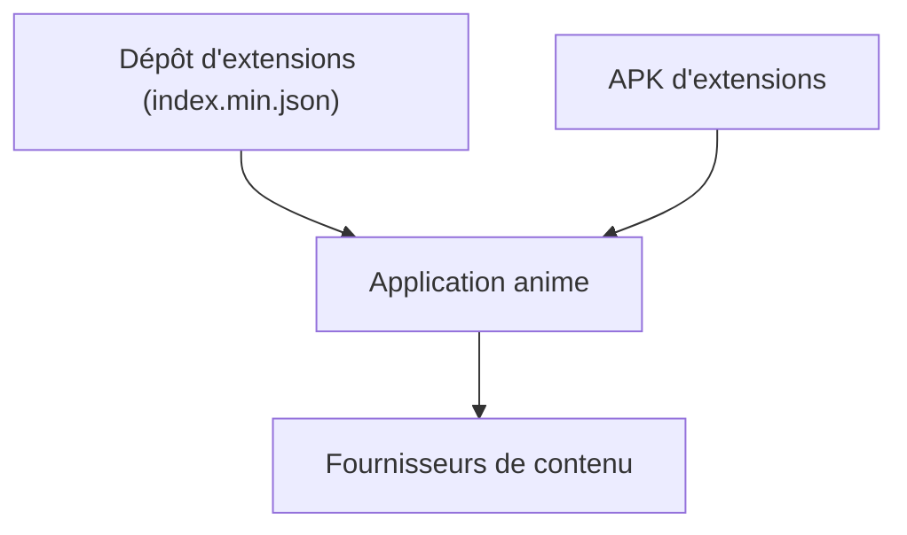

# Kohi-den/extensions-source

> Repository of extensions for an anime app, installable through an index URL.

## The problem
Not documented: the README only describes installation.

## What it actually does
Provides source extensions for anime repositories: you paste an index URL into your extension repository, or download the APKs. The rest is not documented.

## How it is wired
Simplified diagram based on the sheet, no diagram provided.


## Trying it
```bash
# Aucune commande ; coller dans son dépôt d'anime :
# https://kohiden.xyz/Kohi-den/extensions/raw/branch/main/index.min.json
```

## Cost and gotchas
Archived repository. Depends on a third-party server (kohiden.xyz) and on content providers with no affiliation. Content possibly subject to copyright.

## What it is not
Not affiliated with Aniyomi: do not ask its support for help.

## Alternatives
None named in the README.

## For you
Ignore: archived repository, unrelated to your field and with almost no substance.
