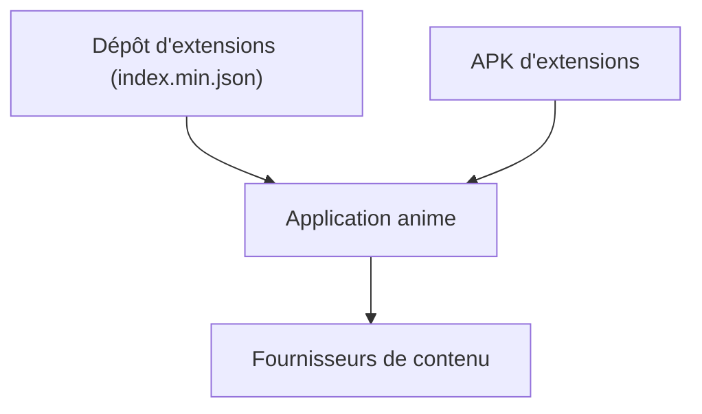

# Kohi-den/extensions-source

> Dépôt d'extensions pour une application d'anime, installables par une URL d'index.

## Le problème
Non documenté : le README ne décrit que l'installation.

## Ce que ça fait vraiment
Fournit des extensions sources pour des dépôts d'anime : on colle une URL d'index dans son dépôt d'extensions, ou l'on télécharge les APK. Le reste n'est pas documenté.

## Comment c'est branché
Schéma simplifié d'après la fiche, sans diagramme fourni.


## Essayer
```bash
# Aucune commande ; coller dans son dépôt d'anime :
# https://kohiden.xyz/Kohi-den/extensions/raw/branch/main/index.min.json
```

## Coût et pièges
Dépôt archivé. Dépend d'un serveur tiers (kohiden.xyz) et de fournisseurs de contenu sans affiliation. Contenu éventuellement soumis au droit d'auteur.

## Ce que ce n'est pas
Pas affilié à Aniyomi : ne pas demander d'aide à son support.

## Alternatives
Aucune nommée dans le README.

## Pour toi
À ignorer : dépôt archivé, sans rapport avec ton métier et à matière quasi nulle.

