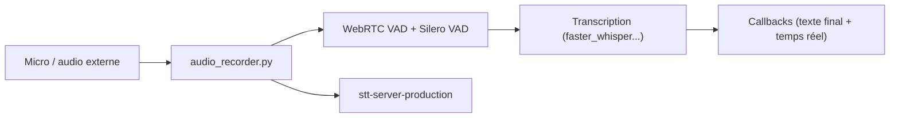

# KoljaB/RealtimeSTT

> Python speech recognition library with voice detection, real-time text and wake words.

## The problem
Wiring microphone, speech detection, transcription and callbacks into a voice assistant takes a lot of glue.

## What it actually does
`AudioToTextRecorder` captures the microphone (or supplied PCM chunks), detects speech (WebRTC VAD then Silero), transcribes with `faster_whisper` by default, and returns final text and real-time text through callbacks. Other engines are offered as extras (sherpa-onnx, Kroko, Moonshine, Parakeet…). A production FastAPI server (HTTP/WebSocket, authentication) is provided as an option. Wake words via Porcupine or OpenWakeWord.

## How it is wired


## Trying it
```bash
pip install "RealtimeSTT[faster-whisper]"
sudo apt-get install python3-dev portaudio19-dev
python -m pip install "RealtimeSTT[server,faster-whisper]"
stt-server-production --host 127.0.0.1 --port 8010
```

## Cost and gotchas
Free. PortAudio required; CI on Python 3.11 and 3.12 only. Keep `if __name__ == "__main__":` (multiprocessing). For CPU, sherpa-onnx models are downloaded separately. A non-loopback server requires a token and TLS; the Kroko engine has paid commercial models for production.

## What it is not
Not a recognition model: it orchestrates third-party engines, whose licenses differ (see `Engine licenses`).

## Alternatives
No alternative named in the README.

## For you
Adopt: a direct starting point for a voice assistant or dictation tool in Python, with GPU or CPU, provided you check the license of the chosen engine.
