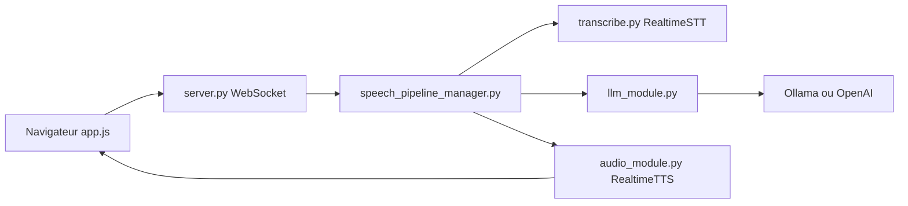

# KoljaB/RealtimeVoiceChat

> Web application to talk out loud with a local LLM or OpenAI, with reduced latency, for AI tinkerers.

## The problem
A complete voice assistant (microphone, transcription, LLM, synthesis, barge-in) requires assembling four real-time building blocks yourself.

## What it actually does
The browser captures the microphone and sends audio chunks over WebSocket to a FastAPI server (`server.py`). `SpeechPipelineManager` chains transcription (RealtimeSTT), end-of-turn detection (`turndetect.py`), the LLM (Ollama by default, OpenAI possible via `llm_module.py`) and then speech synthesis (Kokoro, Coqui or Orpheus via `audio_module.py`). Audio streams back and the user can interrupt. Tuning is done by editing the Python files.

## How it is wired


## Trying it
```bash
git clone https://github.com/KoljaB/RealtimeVoiceChat.git
cd RealtimeVoiceChat
docker compose build
docker compose up -d
docker compose exec ollama ollama pull hf.co/bartowski/huihui-ai_Mistral-Small-24B-Instruct-2501-abliterated-GGUF:Q4_K_M
# puis http://localhost:8000
```

## Cost and gotchas
An NVIDIA GPU (CUDA 12.1) is strongly recommended, with the NVIDIA Container Toolkit on Linux; building the images is slow. Any config change must be made before `docker compose build`. An OpenAI key is needed only if that backend is chosen.

## What it is not
Not a maintained project: the author writes that they no longer provide new features or support, and only reviews a few PRs. No license is declared: reusing the code is legally uncertain. The default Ollama model is a 24B, heavy for a modest machine.

## Alternatives
No alternative is cited in the README; the RealtimeSTT and RealtimeTTS building blocks (same author) can be reused separately.

## For you
Ignore as a project base (no license, no longer maintained, 41 open issues), but the STT / turn-taking / LLM / TTS split remains a good read for understanding a voice pipeline.
