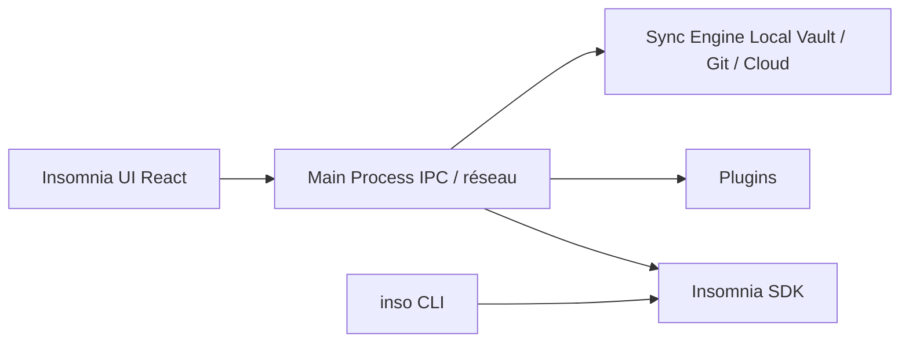

# Kong/insomnia

> Open-source API client for REST, GraphQL, gRPC, WebSocket and SSE, with design, tests and mocks.

## The problem
Testing, documenting and sharing API calls often takes several tools that do not sync with each other.

## What it actually does
Desktop application (Electron, React) to debug APIs, edit OpenAPI specifications, write test suites, run collections and mock APIs. Three storage options: Local Vault (100% local), Git Sync, Cloud Sync (end-to-end encryption possible). An `inso` CLI is available for CI, and plugins can be installed.

## How it is wired


## Trying it
```bash
npm i
npm run lint
npm run type-check
npm test
npm run dev
./packages/insomnia-inso/bin/inso -v
```

## Cost and gotchas
Free with the local Scratch Pad; most features require an account, and premium features are paid. Data can stay local or in Git. Building requires Node.js (see `.nvmrc`).

## What it is not
Not a load-testing or API monitoring tool. The account is requested to fund the product, according to the README.

## Alternatives
- No alternative named in the README.

## For you
Watch: handy for trying out model endpoints or data APIs, but the account required for most features weighs against a plain `curl`.
