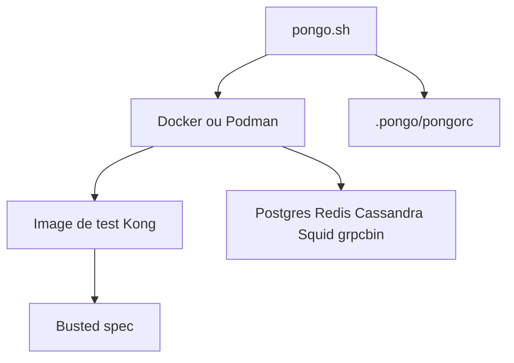

# Kong/kong-pongo

> Command-line tool to test Kong plugins in containers, for plugin developers.

## The problem
Testing a Kong plugin requires assembling Kong, Postgres and its test dependencies by hand.

## What it actually does
The `pongo` script builds a Kong test image, starts the dependencies (Postgres, Cassandra, Redis, grpcbin, Squid) in Docker or Podman, then runs the Busted tests. It also offers lint, pack, shell, logs and limited LuaCov coverage.

## How it is wired
Simplified diagram based on the fiche, no diagram provided.



## Trying it
```bash
PATH=$PATH:~/.local/bin
git clone https://github.com/Kong/kong-pongo.git
mkdir -p ~/.local/bin
ln -s $(realpath kong-pongo/pongo.sh) ~/.local/bin/pongo
git clone https://github.com/Kong/kong-plugin.git
cd kong-plugin
pongo run
```

## Cost and gotchas
Free. It needs a container engine, curl and realpath. Behind a proxy, image building may fail; `PONGO_INSECURE` disables SSL verification, to be used knowingly.

## What it is not
Not a testing tool for anything other than Kong plugins. The README also warns that LuaCov coverage does not see integration tests.

## Alternatives
No alternative named in the README.

## For you
Worth watching: useful only if you write plugins for the Kong gateway, which is rare in a data, AI or MLOps profile.
