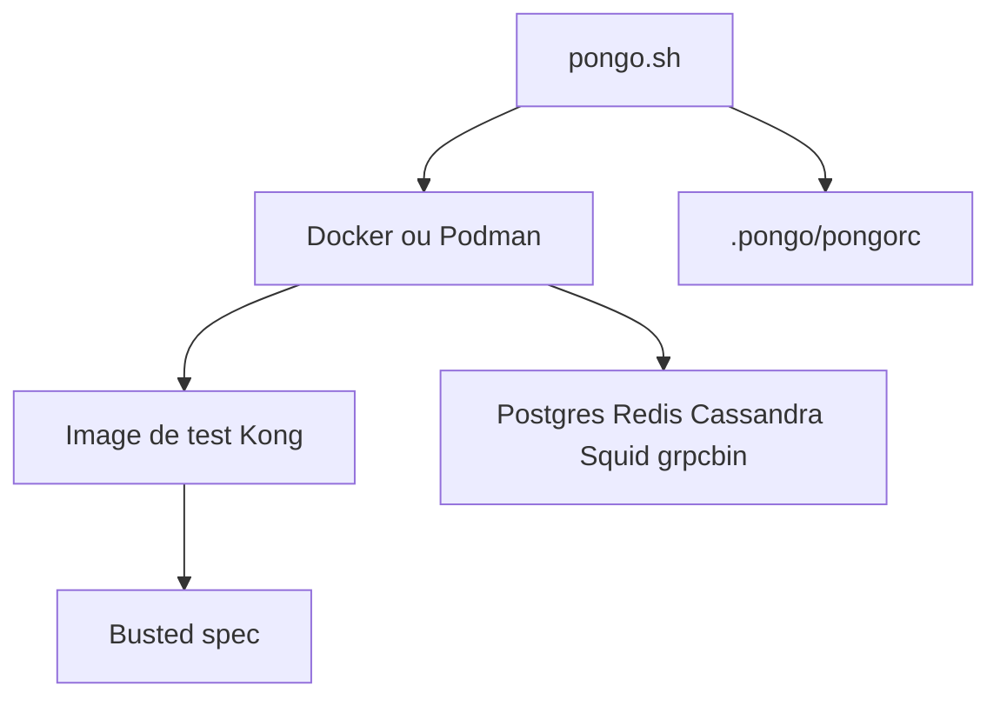

# Kong/kong-pongo

> Outil en ligne de commande pour tester des plugins Kong dans des conteneurs, pour développeurs de plugins.

## Le problème
Tester un plugin Kong demande d'assembler Kong, Postgres et ses dépendances de test à la main.

## Ce que ça fait vraiment
Le script `pongo` construit une image de test Kong, démarre les dépendances (Postgres, Cassandra, Redis, grpcbin, Squid) dans Docker ou Podman, puis lance les tests Busted. Il offre aussi lint, pack, shell, logs et une couverture LuaCov limitée.

## Comment c'est branché
Schéma simplifié d'après la fiche, sans diagramme fourni.



## Essayer
```bash
PATH=$PATH:~/.local/bin
git clone https://github.com/Kong/kong-pongo.git
mkdir -p ~/.local/bin
ln -s $(realpath kong-pongo/pongo.sh) ~/.local/bin/pongo
git clone https://github.com/Kong/kong-plugin.git
cd kong-plugin
pongo run
```

## Coût et pièges
Gratuit. Il faut un moteur de conteneurs, curl et realpath. Derrière un proxy, la construction d'images peut échouer ; `PONGO_INSECURE` désactive la vérification SSL, à utiliser en connaissance de cause.

## Ce que ce n'est pas
Pas un outil de test pour autre chose que des plugins Kong. Le README prévient aussi que la couverture LuaCov ne voit pas les tests d'intégration.

## Alternatives
Aucune alternative nommée dans le README.

## Pour toi
À surveiller : utile seulement si tu écris des plugins pour la passerelle Kong, ce qui est rare dans un profil data, IA ou MLOps.

