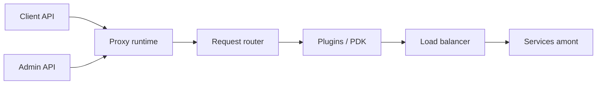

# Kong/kong

> Plugin-extensible API gateway, extended to LLM and MCP traffic, for platform teams.

## The problem
Each microservice reimplements authentication, rate limiting and logging; traffic to LLMs has no common control point.

## What it actually does
A proxy receives the request, matches it to a route, applies the configured plugins, load-balances to the upstream and returns the response. Configuration via the Admin API or declaratively (database mode or DB-less mode). The AI plugins route between LLM providers and govern MCP traffic.

## How it is wired


## Trying it
```cmd
git clone https://github.com/Kong/docker-kong
cd docker-kong/compose/
KONG_DATABASE=postgres docker-compose --profile database up
```
Ports: 8000 (traffic), 8001 (Admin API), 8002 (Kong Manager).

## Cost and gotchas
Free when self-hosted; the commercial Konnect layer (SaaS, support) is paid. Postgres is required outside DB-less mode.

## What it is not
Not a framework for building agents: a network layer in front of them. Some advanced features are tied to the commercial offering.

## Alternatives
No alternative named in the README.

## For you
Watch: interesting for centralizing a team's LLM calls in MLOps, heavy if you only have one or two services.
