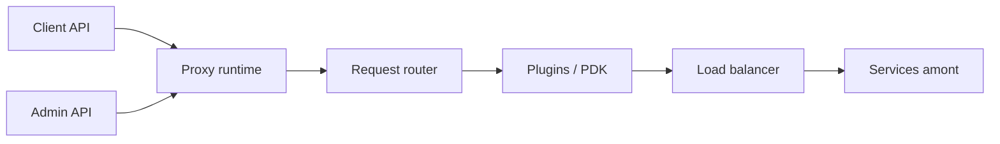

# Kong/kong

> Passerelle d'API extensible par plugins, étendue au trafic LLM et MCP, pour équipes plateforme.

## Le problème
Chaque microservice réimplémente authentification, limitation de débit et journalisation ; le trafic vers les LLM n'a aucun point de contrôle commun.

## Ce que ça fait vraiment
Un proxy reçoit la requête, la fait correspondre à une route, applique les plugins configurés, répartit la charge vers l'amont et renvoie la réponse. Configuration par l'Admin API ou en déclaratif (mode avec base ou sans base). Les plugins IA routent entre fournisseurs LLM et gouvernent le trafic MCP.

## Comment c'est branché


## Essayer
```cmd
git clone https://github.com/Kong/docker-kong
cd docker-kong/compose/
KONG_DATABASE=postgres docker-compose --profile database up
```
Ports : 8000 (trafic), 8001 (Admin API), 8002 (Kong Manager).

## Coût et pièges
Gratuit en auto-hébergement ; la couche commerciale Konnect (SaaS, support) est payante. Postgres requis hors mode DB-less.

## Ce que ce n'est pas
Pas un framework de construction d'agents : une couche réseau devant eux. Certaines fonctions avancées sont rattachées à l'offre commerciale.

## Alternatives
Aucune alternative nommée dans le README.

## Pour toi
Surveiller : intéressant pour centraliser les appels LLM d'une équipe MLOps, lourd si tu n'as qu'un ou deux services.

