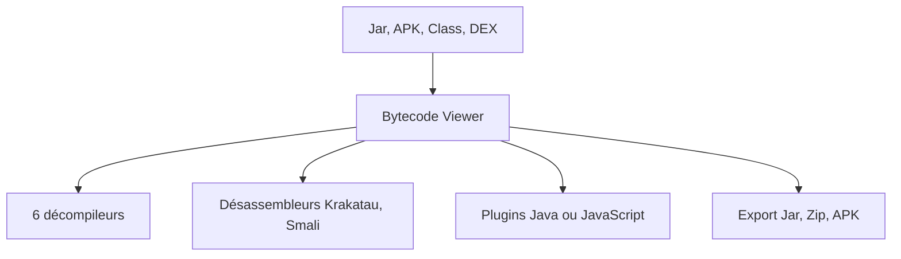

# Konloch/bytecode-viewer

> Java and Android reverse-engineering GUI: decompiles and disassembles jars, classes and APKs.

## The problem
Understanding a jar or an APK without its sources means chaining several command-line decompilers.

## What it actually does
Drag and drop a file (Class, Jar, APK, DEX, XAPK, WAR…) then display up to three decompilers side by side among six (Krakatau, CFR, Procyon, FernFlower, JADX, JD-GUI). Includes disassemblers, a Java compiler, static search and a Java or JavaScript plugin system. A command-line interface exists.

## How it is wired
Simplified diagram based on the sheet, no diagram supplied.


## Trying it
```bash
java -jar Bytecode-Viewer-2.10.x.jar
mvn package
```

## Cost and gotchas
Free. Java required (a real need, not listed in the prerequisites); for large files, relaunch with more memory (`java -Xmx3G -jar BCV.jar`). The interface can lag with the default theme.

## What it is not
It is not a everyday development tool but a binary analysis tool. It is not for analyzing data.

## Alternatives
No alternative named in the README (the built-in decompilers are its components).

## For you
Ignore: Java/Android reverse engineering, outside the data / AI / MLOps scope, except for an occasional library audit need.
