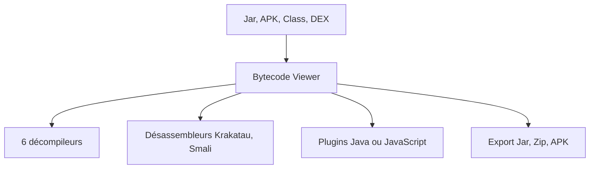

# Konloch/bytecode-viewer

> Interface graphique de rétro-ingénierie Java et Android : décompile et désassemble jars, classes et APK.

## Le problème
Comprendre un jar ou un APK dont on n'a pas les sources oblige à enchaîner plusieurs décompileurs en ligne de commande.

## Ce que ça fait vraiment
Glisser-déposer un fichier (Class, Jar, APK, DEX, XAPK, WAR…) puis afficher jusqu'à trois décompileurs côte à côte parmi six (Krakatau, CFR, Procyon, FernFlower, JADX, JD-GUI). Inclut des désassembleurs, un compilateur Java, une recherche statique et un système de plugins Java ou JavaScript. Une interface en ligne de commande existe.

## Comment c'est branché
Schéma simplifié d'après la fiche, sans diagramme fourni.


## Essayer
```bash
java -jar Bytecode-Viewer-2.10.x.jar
mvn package
```

## Coût et pièges
Gratuit. Java requis (besoin réel, non listé dans les prérequis) ; pour les gros fichiers, relancer avec plus de mémoire (`java -Xmx3G -jar BCV.jar`). L'interface peut ramer avec le thème par défaut.

## Ce que ce n'est pas
Ce n'est pas un outil de développement courant mais un outil d'analyse de binaires. Il ne sert pas à analyser des données.

## Alternatives
Aucune alternative nommée dans le README (les décompileurs intégrés sont ses composants).

## Pour toi
À ignorer : rétro-ingénierie Java/Android, hors du périmètre data / IA / MLOps, sauf besoin ponctuel d'audit de bibliothèque.

