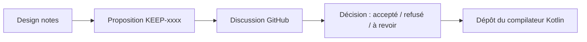

# Kotlin/KEEP

> Repository of proposals for the evolution of the Kotlin language and its standard library, for those who follow the language.

## The problem
Knowing why and how Kotlin evolves requires access to the design discussions and decisions.

## What it actually does
Stores numbered proposals (KEEP) in Markdown, each with a status (Public discussion, In progress, Experimental, Stable, Declined, Superseded). Each proposal opens a public GitHub discussion before the final decision. The "design notes" gather ideas that are not yet mature. The implementation lives in the Kotlin compiler repository.

## How it is wired

## Trying it
No documented command. Read the `KEEP-xxxx-*.md` files; take part through the proposal's GitHub discussion.

## Cost and gotchas
Free. The up-to-date status is in the header of each document; full tracking also goes through YouTrack.

## What it is not
Not executable code nor Kotlin usage documentation. A proposal is not a guarantee of implementation.

## Alternatives
No alternative named in the README.

## For you
Worth watching: useful only if you write Kotlin; otherwise, no direct value for data/AI.
