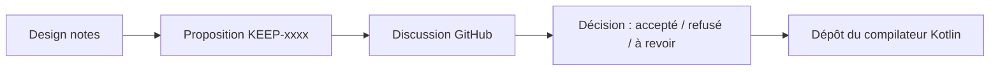

# Kotlin/KEEP

> Dépôt des propositions d'évolution du langage Kotlin et de sa bibliothèque standard, pour qui suit le langage.

## Le problème
Savoir pourquoi et comment Kotlin évolue demande d'accéder aux discussions et aux décisions de conception.

## Ce que ça fait vraiment
Stocke les propositions (KEEP) numérotées en Markdown, chacune avec un statut (Public discussion, In progress, Experimental, Stable, Declined, Superseded). Chaque proposition ouvre une discussion GitHub publique avant la décision finale. Les « design notes » regroupent des idées pas encore mûres. L'implémentation vit dans le dépôt du compilateur Kotlin.

## Comment c'est branché

## Essayer
Aucune commande documentée. Lire les fichiers `KEEP-xxxx-*.md` ; participer via la discussion GitHub de la proposition.

## Coût et pièges
Gratuit. Le statut à jour est dans l'en-tête de chaque document ; le suivi complet passe aussi par YouTrack.

## Ce que ce n'est pas
Pas du code exécutable ni de la documentation d'usage de Kotlin. Une proposition n'est pas une garantie d'implémentation.

## Alternatives
Aucune alternative nommée dans le README.

## Pour toi
À surveiller : utile seulement si tu écris du Kotlin ; sinon, sans valeur directe pour data/IA.

