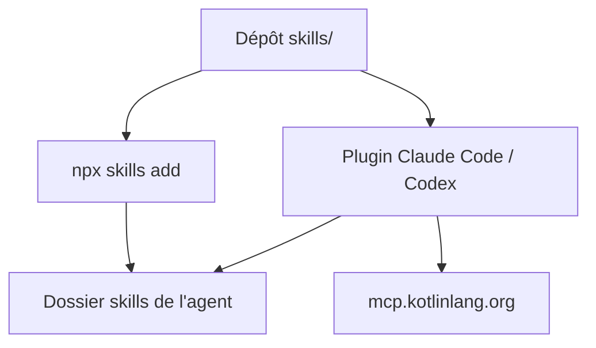

# Kotlin/kotlin-agent-skills

> Collection of coding-agent skills for Kotlin projects, plus access to the Kotlin docs MCP server.

## The problem
Coding agents handle Spring, JPA or build tools in Kotlin poorly without targeted guidance.

## What it actually does
Repository of skill folders following the Agent Skills standard, named `kotlin-<category>-<name>` (backend and tooling categories), for example a migration to AGP 9. It is installed via the skills CLI, as a Claude Code or Codex plugin, or by manual copy. The plugin also enables the `mcp.kotlinlang.org` MCP server to search the docs.

## How it is wired


Simplified diagram based on the sheet, no diagram provided.

## Trying it
```bash
npx skills add Kotlin/kotlin-agent-skills
claude plugin marketplace add Kotlin/kotlin-agent-skills
claude plugin install kotlin-agent-skills@Kotlin
cp -r skills/kotlin-tooling-agp9-migration .claude/skills/
```

## Cost and gotchas
Free; your agents remain paid. The list of skills is not in the README, you have to open `skills/`.

## What it is not
Not a Kotlin library nor a code analysis tool: these are instructions for agents. The precise content of the skills is not described here.

## Alternatives
No alternative named in the README.

## For you
Worth watching: only useful if you write Kotlin or Spring with an agent; the fact that JetBrains is behind it suggests ongoing maintenance.
