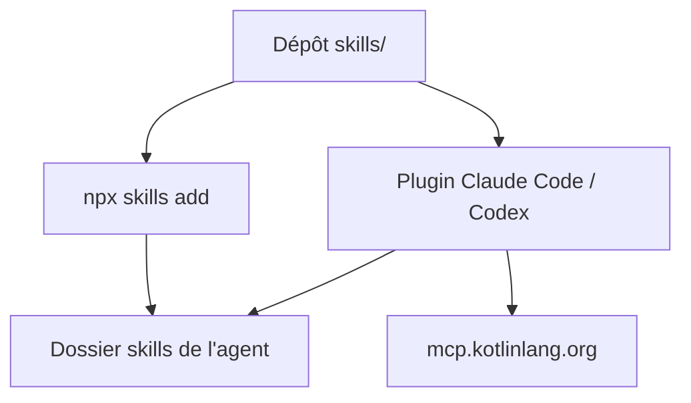

# Kotlin/kotlin-agent-skills

> Collection de skills d'agents de code pour projets Kotlin, plus l'accès au serveur MCP de la doc Kotlin.

## Le problème
Les agents de code utilisent mal Spring, JPA ou les outils de build en Kotlin sans consignes ciblées.

## Ce que ça fait vraiment
Dépôt de dossiers de skills au standard Agent Skills, nommés `kotlin-<catégorie>-<nom>` (catégories backend et tooling), par exemple une migration vers AGP 9. Il s'installe via la CLI skills, comme plugin Claude Code ou Codex, ou par copie manuelle. Le plugin active aussi le serveur MCP `mcp.kotlinlang.org` pour chercher dans la doc.

## Comment c'est branché


Schéma simplifié d'après la fiche, sans diagramme fourni.

## Essayer
```bash
npx skills add Kotlin/kotlin-agent-skills
claude plugin marketplace add Kotlin/kotlin-agent-skills
claude plugin install kotlin-agent-skills@Kotlin
cp -r skills/kotlin-tooling-agp9-migration .claude/skills/
```

## Coût et pièges
Gratuit ; tes agents restent payants. La liste des skills n'est pas dans le README, il faut ouvrir `skills/`.

## Ce que ce n'est pas
Pas une bibliothèque Kotlin ni un outil d'analyse de code : ce sont des instructions pour agents. Le contenu précis des skills n'est pas décrit ici.

## Alternatives
Aucune alternative nommée dans le README.

## Pour toi
À surveiller : utile seulement si tu écris du Kotlin ou du Spring avec un agent ; le portage par JetBrains laisse espérer un suivi.

