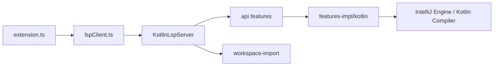

# Kotlin/kotlin-lsp

> Official JetBrains Kotlin language server, based on IntelliJ, for VS Code and other editors.

## The problem
Outside IntelliJ, Kotlin editing lacks reliable completion, diagnostics and navigation.

## What it actually does
LSP server based on the IntelliJ platform and its Kotlin plugin, with a VS Code extension. It imports Gradle, JSON or JPS projects. Launch scripts exist for Neovim, Emacs and Zed. Part of the code, coming from JetBrains Air and Fleet, is proprietary.

## How it is wired


## Trying it
```bash
brew install JetBrains/utils/kotlin-lsp
chmod +x $KOTLIN_LSP_DIR/kotlin-lsp.sh
ln -s $KOTLIN_LSP_DIR/kotlin-lsp.sh $HOME/.local/bin/kotlin-lsp
```

## Cost and gotchas
Free. The project is in alpha and partly closed. Read-only mirror repository: no code contributions. The VS Code extension identifier has changed.

## What it is not
Not a fully open-source or stable server: the README mentions alpha and proprietary components.

## Alternatives
No alternative named in the README.

## For you
Ignore: only useful if you write Kotlin outside IntelliJ, which is rare in a data/AI profile.
