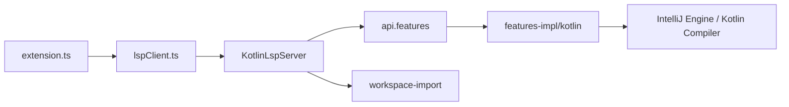

# Kotlin/kotlin-lsp

> Serveur de langage Kotlin officiel de JetBrains, fondé sur IntelliJ, pour VS Code et autres éditeurs.

## Le problème
Hors d'IntelliJ, l'édition Kotlin manque de complétion, diagnostics et navigation fiables.

## Ce que ça fait vraiment
Serveur LSP basé sur la plateforme IntelliJ et son greffon Kotlin, avec une extension VS Code. Il importe les projets Gradle, JSON ou JPS. Des scripts de lancement existent pour Neovim, Emacs et Zed. Une partie du code, issue de JetBrains Air et Fleet, est propriétaire.

## Comment c'est branché


## Essayer
```bash
brew install JetBrains/utils/kotlin-lsp
chmod +x $KOTLIN_LSP_DIR/kotlin-lsp.sh
ln -s $KOTLIN_LSP_DIR/kotlin-lsp.sh $HOME/.local/bin/kotlin-lsp
```

## Coût et pièges
Gratuit. Le projet est en alpha et partiellement fermé. Dépôt en miroir en lecture seule : pas de contributions de code. L'identifiant de l'extension VS Code a changé.

## Ce que ce n'est pas
Pas un serveur entièrement open source ni stable : le README parle d'alpha et de composants propriétaires.

## Alternatives
Aucune alternative nommée dans le README.

## Pour toi
À ignorer : utile seulement si tu écris du Kotlin hors IntelliJ, ce qui est rare dans un profil data/IA.

