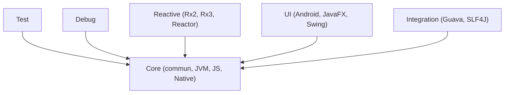

# Kotlin/kotlinx.coroutines

> Multiplatform Kotlin coroutines library for non-blocking asynchronous programming.

## The problem
Writing asynchronous code with callbacks or threads is verbose and hard to cancel cleanly.

## What it actually does
Provides `launch` and `async` with Job and Deferred, dispatchers (Default, IO, Main), `delay`, Flow (cold asynchronous stream), Channel, Mutex, Semaphore, structured scopes and `select`. Modules add testing (`runTest`), debugging (`DebugProbes`), reactive streams (RxJava, Reactor), UI (Android, JavaFX, Swing) and Guava or SLF4J.

## How it is wired


## Trying it
```kotlin
implementation("org.jetbrains.kotlinx:kotlinx-coroutines-core:1.11.0")
```
```kotlin
suspend fun main() = coroutineScope {
    launch { delay(1.seconds); println("Kotlin Coroutines World!") }
    println("Hello")
}
```

## Cost and gotchas
Free. You need the right Kotlin version (2.2.20 for this release) and `mavenCentral()` in your repositories. On Android, add the `kotlinx-coroutines-android` module.

## What it is not
Not a language or a framework: it is a library that assumes Kotlin. Nothing to do with Python's asyncio.

## Alternatives
- eclipse-vertx/vert.x: asynchronous model in Java, based on verticles and an event bus.

## For you
Ignore: useful only if you write Kotlin or Android; a Python data / AI profile has no direct use for it.
