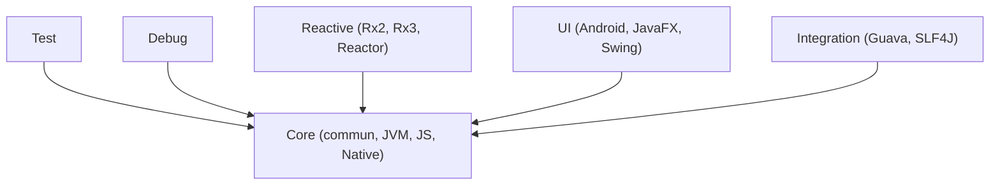

# Kotlin/kotlinx.coroutines

> Bibliothèque de coroutines Kotlin multiplateforme, pour la programmation asynchrone non bloquante.

## Le problème
Écrire du code asynchrone avec des rappels ou des threads est verbeux et difficile à annuler proprement.

## Ce que ça fait vraiment
Fournit `launch` et `async` avec Job et Deferred, des dispatchers (Default, IO, Main), `delay`, Flow (flux asynchrone froid), Channel, Mutex, Semaphore, scopes structurés et `select`. Des modules ajoutent les tests (`runTest`), le débogage (`DebugProbes`), les flux réactifs (RxJava, Reactor), l'UI (Android, JavaFX, Swing) et Guava ou SLF4J.

## Comment c'est branché


## Essayer
```kotlin
implementation("org.jetbrains.kotlinx:kotlinx-coroutines-core:1.11.0")
```
```kotlin
suspend fun main() = coroutineScope {
    launch { delay(1.seconds); println("Kotlin Coroutines World!") }
    println("Hello")
}
```

## Coût et pièges
Gratuit. Il faut la bonne version de Kotlin (2.2.20 pour cette version) et `mavenCentral()` dans les dépôts. Sous Android, ajoute le module `kotlinx-coroutines-android`.

## Ce que ce n'est pas
Pas un langage ni un framework : c'est une bibliothèque qui suppose Kotlin. Rien à voir avec l'asyncio Python.

## Alternatives
- eclipse-vertx/vert.x : modèle asynchrone en Java, par verticles et bus d'événements.

## Pour toi
À ignorer : utile seulement si tu écris du Kotlin ou de l'Android ; un profil data / IA en Python n'a aucun usage direct.

