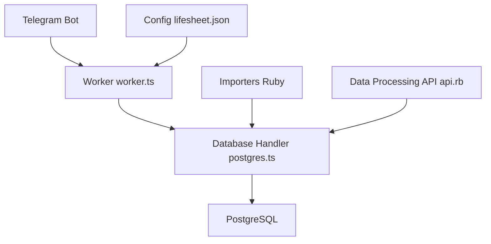

# KrauseFx/FxLifeSheet

> Telegram bot that collects personal life data into PostgreSQL, with visualization, for individual use.

## The problem
Linking sleep, mood, fitness, travel and productivity calls for a single database you control, not spreadsheets.

## What it actually does
A Telegram bot asks questions at regular intervals or on command (`/awake`, `/asleep`, `/week`), configured in `lifesheet.json`. Answers go into PostgreSQL. Ruby importers pull in Apple Health, RescueTime, Spotify, Swarm and weather. A `visual_playground` folder produces the charts.

## How it is wired


## Trying it
```bash
npm run dev
npm run scheduler
```
Before that: create a Postgres database, run `db/create_tables.sql` and set the variables `TELEGRAM_BOT_TOKEN`, `DATABASE_URL` and the others.

## Cost and gotchas
Free, but you need a Telegram bot, a Postgres database and a host for the scheduler (Railway mentioned). Very personal health data. Last push in January 2024.

## What it is not
Not a ready-to-use product: it is the author's personal system. The README claims MIT but the catalog finds no license.

## Alternatives
No alternative named in the README.

## For you
Ignore: too personal, no declared license and inactive since 2024; keep it only as a quantified-self architecture idea.
