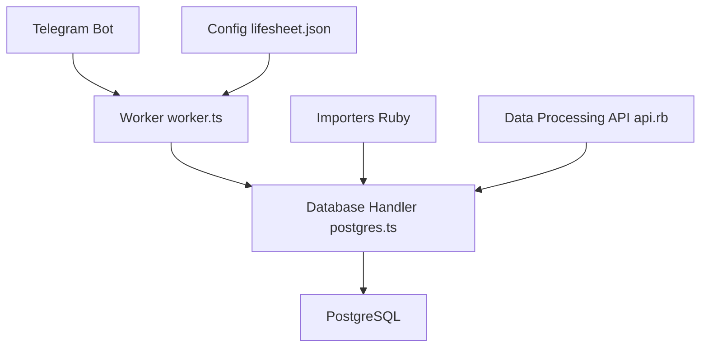

# KrauseFx/FxLifeSheet

> Bot Telegram qui collecte des données de vie personnelles dans PostgreSQL, avec visualisation, pour un usage individuel.

## Le problème
Relier sommeil, humeur, forme, voyages et productivité demande une base unique que l'on contrôle, et pas des feuilles de calcul.

## Ce que ça fait vraiment
Un bot Telegram pose des questions à intervalles réguliers ou sur commande (`/awake`, `/asleep`, `/week`), configurées dans `lifesheet.json`. Les réponses vont dans PostgreSQL. Des importeurs Ruby récupèrent Apple Health, RescueTime, Spotify, Swarm et la météo. Un dossier `visual_playground` produit les graphiques.

## Comment c'est branché


## Essayer
```bash
npm run dev
npm run scheduler
```
Avant cela : créer une base Postgres, exécuter `db/create_tables.sql` et renseigner les variables `TELEGRAM_BOT_TOKEN`, `DATABASE_URL` et les autres.

## Coût et pièges
Gratuit, mais il faut un bot Telegram, une base Postgres et un hébergeur pour le scheduler (Railway cité). Données de santé très personnelles. Dernier push en janvier 2024.

## Ce que ce n'est pas
Pas un produit prêt à l'emploi : c'est le système personnel de l'auteur. Le README annonce du MIT mais le catalogue ne trouve aucune licence.

## Alternatives
Aucune alternative nommée dans le README.

## Pour toi
À ignorer : trop personnel, sans licence déclarée et inactif depuis 2024 ; garde-le seulement comme idée d'architecture de quantified self.

