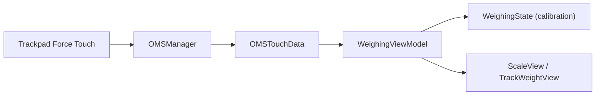

# KrishKrosh/TrackWeight

> macOS app that turns a MacBook's Force Touch trackpad into a digital scale, out of curiosity.

## The problem
No real need: to show that you can read the trackpad's pressure and express it in grams.

## What it actually does
Uses a fork of the Open Multi-Touch Support library to read trackpad pressure events (private macOS access). You must keep a finger in contact and place the object on it while pressing as little as possible. The author claims the data is already in grams and compared it against a reference scale. SwiftUI and Combine interface, MVVM architecture.

## How it is wired


## Trying it
```bash
brew install --cask krishkrosh/apps/trackweight --force
```

## Cost and gotchas
Free. Requires macOS 13+ and a Force Touch MacBook, with the sandbox disabled. Metal objects can skew the measurement. Last push in July 2025.

## What it is not
Not a measuring instrument: the author declares it experimental and advises against any critical or commercial use.

## Alternatives
No alternative named in the README.

## For you
Ignore: a macOS gadget unrelated to data or AI, and not updated for over a year.
