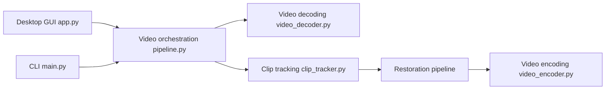

# Kruk2/jasna

> GPU application that detects and restores censorship mosaics in videos and images, for informed users.

## The problem
Removing a mosaic from a video requires processing each frame by hand, with no temporal consistency.

## What it actually does
A pipeline running almost entirely on the GPU: decoding (NVDEC or AMF), mosaic detection (`rfdetr-v6`), tracking in clips up to scene cuts, BasicVSR++ restoration, optional secondary restoration, blending back into the frame, encoding (NVENC or AMF). Graphical interface, CLI, segment editor, video player, VR180. The LTX model (NVIDIA) is reserved for supporters.

## How it is wired


## Trying it
```bash
jasna --input input.mp4 --output output.mkv
jasna --input photo.png --output restored.png
jasna --input input_folder --output output_folder
jasna --help
```

## Cost and gotchas
BasicVSR++ is free; LTX, SD 1.5 and image restoration go through a paid license code (Buy Me a Coffee or other). NVIDIA GTX 16 or RTX 20+ GPU (AMD RX 7000/9000 experimental). First task: 15 to 60 minutes of model preparation.

## What it is not
Not a general-purpose tool: it only restores mosaics. The models and dependencies have their own licenses. The installation path must not contain any non-English characters. Sensitive use: the README does not address consent.

## Alternatives
- Lada (Codeberg): which Jasna draws inspiration from, more economical with GPU memory.

## For you
Keep an eye on it: an interesting GPU video technique, but AGPL license, a single maintainer and a use with no direct link to your job.
