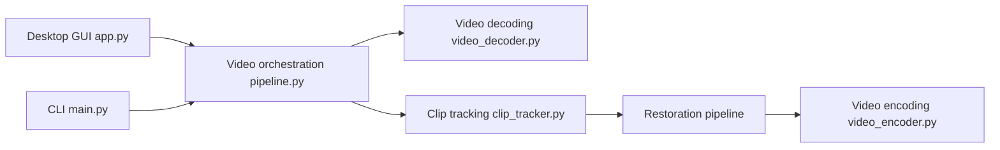

# Kruk2/jasna

> Application GPU qui détecte et restaure les mosaïques de censure dans vidéos et images, pour utilisateurs avertis.

## Le problème
Retirer une mosaïque d'une vidéo demande de traiter chaque image à la main, sans cohérence dans le temps.

## Ce que ça fait vraiment
Pipeline presque entièrement sur GPU : décodage (NVDEC ou AMF), détection des mosaïques (`rfdetr-v6`), suivi en clips jusqu'aux coupures de scène, restauration BasicVSR++, restauration secondaire facultative, fusion dans l'image, encodage (NVENC ou AMF). Interface graphique, CLI, éditeur de segments, lecteur vidéo, VR180. Le modèle LTX (NVIDIA) est réservé aux supporters.

## Comment c'est branché


## Essayer
```bash
jasna --input input.mp4 --output output.mkv
jasna --input photo.png --output restored.png
jasna --input input_folder --output output_folder
jasna --help
```

## Coût et pièges
BasicVSR++ est gratuit ; LTX, SD 1.5 et la restauration d'images passent par un code de licence payant (Buy Me a Coffee ou autre). GPU NVIDIA GTX 16 ou RTX 20+ (AMD RX 7000/9000 expérimental). Première tâche : 15 à 60 minutes de préparation des modèles.

## Ce que ce n'est pas
Pas un outil généraliste : il ne restaure que des mosaïques. Les modèles et dépendances ont leurs propres licences. Le chemin d'installation ne doit contenir aucun caractère non anglais. Usage sensible : le README ne traite pas du consentement.

## Alternatives
- Lada (Codeberg) : dont Jasna s'inspire, plus économe en mémoire GPU.

## Pour toi
À surveiller : technique intéressante de vidéo GPU, mais licence AGPL, un seul mainteneur et un usage qui n'a pas de rapport direct avec ton métier.

