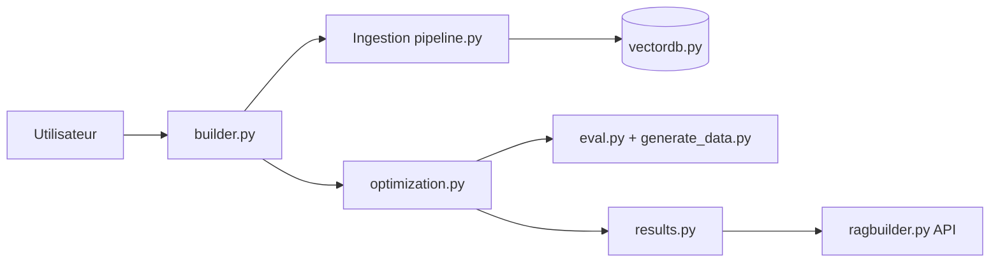

# KruxAI/ragbuilder

> Python library that automatically tunes ingestion, retrieval and generation of a RAG over your data.

## The problem
Choosing chunking, embeddings, retrievers and reranker for a RAG is done by intuition, with no measurement on your own documents.

## What it actually does
`RAGBuilder` runs a Bayesian optimization (Optuna) over ingestion parameters (loaders, splitting, chunk size, embeddings), retrieval (vector, BM25, multi-query, graph via Neo4j, rerankers) and generation, evaluated on a provided or synthetic test set with Ragas. The selected pipeline can be queried, saved, reloaded or served via `POST /query`.

## How it is wired


## Trying it
```bash
uv venv ragbuilder
source ragbuilder/bin/activate
uv pip install ragbuilder
```
```python
from ragbuilder import RAGBuilder
builder = RAGBuilder.from_source_with_defaults(input_source='https://lilianweng.github.io/posts/2023-06-23-agent/')
results = builder.optimize()
```

## Cost and gotchas
`OPENAI_API_KEY` required (Azure, Mistral, Cohere optional): each optimization trial consumes LLM calls. Neo4j for the graph retriever. Anonymous analytics on by default, can be disabled with `ENABLE_ANALYTICS=False`.

## What it is not
Not a ready-to-use RAG: it is a tuning tool. Last push in May 2025; a README example uses an undefined variable (`adv_results`). `serve` listens on 0.0.0.0.

## Alternatives
No alternative named in the README (Ragas is used internally).

## For you
Worth watching: the idea of automated RAG tuning is relevant, but the repository has not moved in sixteen months.
